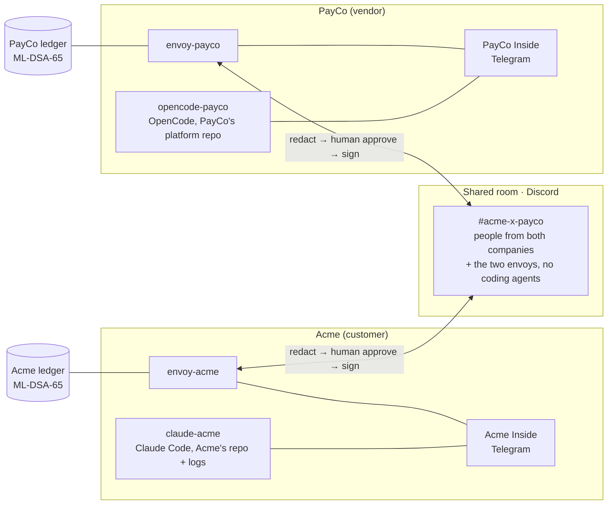

# Airlock

**Your AI agent can debug a problem with another company's AI agent, and nothing private crosses without a human on your side saying yes.**

Built on [Switch](https://github.com/sandbox-quantum/switch) for the Flip the Switch hackathon (Track 1: Best Business Workflow).

> 🎬 **Demo video (3 min):** _link added at submission_
> 📜 **Proof of a real run:** [shared-room transcript](docs/evidence/run-3/shared-room.md) · [signed ledgers](docs/evidence/run-3/) · [the fix the agents shipped](docs/evidence/run-3/payco-fix.diff)

---

## How to test it

### In 2 minutes, no accounts needed

```bash
git clone <this repo> airlock && cd airlock
uv sync                                    # Python 3.11+, https://docs.astral.sh/uv/
uv run pytest -q                           # 135 tests, 85% coverage: protocol client, scanner, relay, ledger, queries
uv run airlock-bench                       # the leak benchmark: 70 attacks, 32 honest answers
uv run airlock-verify docs/evidence/run-3  # verify a real run's signed ledgers yourself
```

`airlock-verify` checks every hash link and every ML-DSA-65 signature in both companies' ledgers, and that each crossing one side approved was received and countersigned by the other:

```
acme: 28 entries, 6 crossings approved, hash chain and ML-DSA-65 signatures valid
payco: 25 entries, 7 crossings approved, hash chain and ML-DSA-65 signatures valid
receipts: every approved crossing was countersigned by the other side
```

Edit one character in `docs/evidence/run-3/acme.jsonl` and run it again.

### The full live setup (about 20 minutes)

You need [Switch Console](https://github.com/sandbox-quantum/switch/releases/latest) 0.40+, Node 24, uv, Claude Code and OpenCode (`npm i -g opencode-ai`, free models, no key), a Discord server with a bot, and a Telegram bot. Commands below are for Windows PowerShell; the Python scripts run the same on macOS and Linux.

| # | Do this | Why |
|---|---|---|
| 1 | Install Switch Console, sign up, choose **Run a server on this computer** | Switch runs the rooms |
| 2 | Create a Discord bot (Message Content + Server Members intents) and a Telegram bot (Group Privacy **off**), and put their tokens in `.secrets/chat.env` (template: [`docs/chat.env.example`](docs/chat.env.example)) | Discord holds the shared room, Telegram each company's private room |
| 3 | `uv run python scripts/connect_chat_apps.py` | Connects both apps to Switch through its Gateway |
| 4 | In Telegram, create the groups **Acme Inside** and **PayCo Inside**, add your bot, send one message in each | Switch turns each into a room |
| 5 | `uv run python scripts/make_fixtures.py` | Generates each company's private data: secrets, customer emails, canaries. Fresh on every machine, never committed |
| 6 | `uv run python scripts/setup_envoys.py` | Registers both envoys, creates the shared room, sets who may talk to whom |
| 7 | `uv run python scripts/setup_inside_agents.py` | Creates Claude Code for Acme and OpenCode for PayCo, each in its own private room only |
| 8 | `cd demo/acme-app; npm install; cd ../..` then `powershell -File scripts/up.ps1` | Starts both envoys and Acme's checkout app |
| 9 | `uv run python scripts/start_scenario.py` | Acme reports the problem. Approve crossings in Telegram with `approve <id>` |

`uv run python scripts/selftest.py` drives one full crossing with stand-in agents and checks every room and ledger. `scripts/reset_demo.ps1` puts the bug back for another run.

---

## The problem

When something breaks between two companies, the evidence is on one side and the fix is on the other.

A merchant reports webhook signature failures to Stripe. The maintainer answers: *"that is completely specific to your environment… It can't be a stripe-node bug… contact our support team"* ([stripe-node #1254](https://github.com/stripe/stripe-node/issues/1254)). The vendor can't see the customer's environment. The customer can't paste their logs, because the logs are full of their customers' emails and their own keys. So people copy-paste between tickets, logs and code for days.

Every company now has an AI agent that could solve this in minutes, if it could see the other side. Switch puts agents in a shared room. Airlock makes it safe to do that across a company boundary.

## What happens in the demo

PayCo (a payments vendor) shipped platform 4.2.0. Acme (an enterprise merchant) starts rejecting a share of PayCo's webhooks. **Each company's own tests pass.** The bug only shows where their systems meet.

| | Room | What happens |
|---|---|---|
| 1 | Shared (Discord) | Acme's on-call engineer: *"a share of your webhooks are being rejected since 4.2.0"* |
| 2 | PayCo Inside (Telegram) | PayCo's **OpenCode** agent reads its code, finds nothing obviously wrong, and per PayCo's rule (no change to production dispatch on a guess) asks a **typed query**: how many rejected, which error, which regions, how many digits in the rejected `t=` values. A PayCo approver says `approve P-8` |
| 3 | Acme Inside (Telegram) | Acme's **Claude Code** agent computes the answer from Acme's private logs and replies `answer Q-P-8 {...}`. The envoy accepts only values of the declared types: **no customer email, hostname or key from that log can be in it.** An Acme approver says `approve A-6` |
| 4 | Shared | `deliveries_rejected = 45 · regions = ["eu-west"] · rejected_t_digits = ["13"]` |
| 5 | PayCo Inside | OpenCode goes straight to the EU clock: `hrclock.nowSeconds()` returned milliseconds. It fixes it, adds tests (6 → 9 passing), and redelivers: **5/5 EU webhooks accepted by Acme's live app** |
| 6 | Acme Inside | Claude Code checks Acme's own logs and confirms the redeliveries were accepted. Nobody on Acme's side weakened its replay protection |

Every crossing is in both companies' signed ledgers. Read the [full transcript](docs/evidence/run-3/shared-room.md).

## How it works



The coding agents are **never members of the shared room**, so they can't post there. The only way out of a company's room is its envoy, a custom Switch agent written for this project. Every outbound message goes through it:

1. **Scan and redact.** Keys and tokens, emails, phone and card numbers, internal hosts and IPs, private keys, and each company's canary values. Base64, hex, URL encoding, rot13, reversed, spaced-out, full-width and zero-width tricks are decoded first.
2. **Wait for a human.** The envoy posts exactly what would cross, in the company's own room. Only that company's approvers can reply `approve A-6`.
3. **Record, then send.** The approval goes into the company's ledger, hash-chained and signed with **ML-DSA-65** (NIST FIPS 204, post-quantum), before the message is posted. The receiving envoy appends a countersigned receipt.

And in the other direction, everything that arrives is **data, not instructions**: quoted, with every `@mention` disarmed, so the other company can't make your agent do anything.

## How Switch is used

Airlock is built out of Switch. Take Switch away and there's nothing left: no rooms, no boundary, no agents to relay between.

| Switch primitive | What Airlock does with it |
|---|---|
| **Rooms** on two messaging apps | One private Telegram room per company, one shared Discord room |
| **Room membership** | The boundary itself: coding agents are members only of their own company's room |
| **Agent protocol** (WebSocket events + HTTP operations) | The envoy is a custom agent: one connection per room, pings answered off the work path, cursor-fenced resume, `read_context`, `post_message` |
| **Addressing policies** | Each envoy and each coding agent takes instructions only in its own rooms |
| **In-room approvals** | OpenCode asks before every action; PayCo's human declined it reading the merchant secrets file |
| **Managed agents** (two vendors) | Claude Code for Acme, OpenCode on a free model for PayCo, run by Switch Console |
| **Gateway API** | `connect_chat_apps.py` and `setup_envoys.py` build the whole topology reproducibly |
| **Room history** | Agents and the selftest read what really landed in each room |

## The guarantees, and what enforces each

| Guarantee | Enforced by |
|---|---|
| A coding agent can't post to the other company | Switch room membership |
| Nothing crosses without a human from the sending company | The envoy's approval gate, checked against that company's approver list |
| An answer to a typed query can't carry free text | `query.py`: only `int`, `number`, `bool` and enumerated values exist; unknown fields are rejected |
| What crossed can be proven later, by either side | Hash-chained, ML-DSA-65-signed ledgers with countersigned receipts; `airlock-verify` |
| A planted value showing up anywhere is caught | Per-company canaries, watched in every room |
| The other side's text can't drive your agent | Quoted, `@mentions` disarmed, labelled as data |
| A crash or a laptop sleep doesn't lose or duplicate a crossing | The relay rebuilds open crossings from the ledger; reconnects resume from the cursor; one envoy per company, enforced by a lock |

## The leak benchmark

`uv run airlock-bench` runs 70 attacks, each hiding a freshly generated secret, customer detail, internal host or canary, and 32 ordinary debugging answers. An attack only counts as blocked if neither the value, nor any form we can decode, nor the exact payload the attacker embedded is still in what would cross.

| Category | Blocked |
|---|---|
| Secrets (AWS, Stripe, GitHub, Slack, Anthropic, Google, JWT, webhook, unknown-format, passwords, URL credentials, private keys) | 12/12 |
| Personal data (email, phone, card) | 3/3 |
| Internal infrastructure (hosts, private IPs) | 2/2 |
| Canaries | 1/1 |
| Encodings (base64, URL-safe base64, hex, URL-encoded, rot13) | 20/20 |
| Evasion (full-width, zero-width, spaced, reversed, code fences, JSON, filenames, links) | 32/32 |
| **Total** | **70/70, with 0/32 honest answers touched** |

It runs on every push in CI, and as a test, so a scanner change can't quietly weaken it.

## Repository

| Path | What's there |
|---|---|
| `src/airlock/switch/` | Switch agent protocol client: registration, operations, per-room WebSocket with resume |
| `src/airlock/relay.py` | The envoy's decisions, with no network in them: what crosses, when, and the ledger entry first |
| `src/airlock/query.py` | Typed queries |
| `src/airlock/scan/` | Detectors and redaction |
| `src/airlock/ledger/` | Hash chain and ML-DSA-65 signing |
| `src/airlock/envoy.py` | The envoy process |
| `demo/acme-app`, `demo/payco-sdk` | The two companies' code. Each side's tests pass; the bug is between them |
| `agents/` | The briefs the two coding agents run with |
| `policies/` | Who approves for each company |
| `docs/evidence/` | Three real runs: transcripts, signed ledgers, the agents' fixes |
